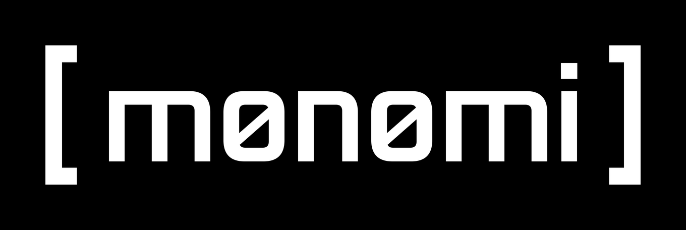

<p align="center">
  <picture>
    <source media="(prefers-color-scheme: dark)" srcset="https://raw.githubusercontent.com/0x41io/monomi/main/assets/monomi-dark.png">
    <source media="(prefers-color-scheme: light)" srcset="https://raw.githubusercontent.com/0x41io/monomi/main/assets/monomi-light.png">
    
  </picture>
</p>

**mønømi: passive attack surface recon and IP threat-intel, with AI-written analysis and an MCP server, by 0x41.**

Most recon tools hand you a raw list of hostnames. Monomi collects a domain's public footprint and then has Claude explain it in plain English: how the infrastructure is organized, what deserves a closer look, how an attacker would most likely get in, and who should fix what first.

> ⚠️ **Authorized use only.** By default Monomi is fully passive: it reads public Certificate Transparency logs and never sends traffic to the target. The optional `--enrich`, `--email` and `--takeover` steps add standard DNS lookups. Two optional checks are **active** — they contact the target's own servers: `--fingerprint` (one homepage request per host) and `--exposed-files` (a few requests per host to find public API specs and source maps). Both send an honest active User-Agent and only run when you ask for them, and `--scope FILE` limits them to the hosts you're allowed to test (over MCP a scope file is required). Only assess domains you own or have permission to review.
---

## Features
- **Subdomain discovery** from Certificate Transparency logs via three sources, asked in parallel:
  - [crt.sh](https://crt.sh) website (broadest coverage, includes expired certificates)
  - crt.sh's public certificate database (same data as the website, queried directly over PostgreSQL; often answers when the website is slow or down)
  - [Cert Spotter](https://sslmate.com/certspotter/) (currently valid certificates, more reliable; waits and retries when rate-limited)
- **Automatic fallback:** if a source is down, the scan continues with the others. A scan is only left out of history when both crt.sh sources fail, since crt.sh is the only one with full certificate history
- **Saved source copies:** every good answer from a source is saved per domain (`scans/<domain>/sources/`). If that source fails on a later run, Monomi uses the saved copy (up to 30 days old) and labels it `from_saved` with its original collection time, so an outage only costs fresh data, not the hosts found before
- **Shared pacing:** crt.sh (5 requests a minute) and Cert Spotter's free tier are paced across every run and domain, so multi-domain sweeps stay under their limits. After Cert Spotter rate-limits, it is skipped for the rest of the cooldown instead of failing on every domain
- **Honest source status:** when the crt.sh database answers with 0 certificates while another source found some, crt.sh is reported as **behind** (it can take days to index new certificates), not as failed
- **Merged, de-duplicated results**
- **Hosting enrichment (`--enrich`):** resolves each host to its IP and looks up the network owner (ASN), provider, and country via Team Cymru's free IP-to-ASN service. Shows a host table, a hosting breakdown chart, and flags hosts that point to private/internal IPs in public DNS. Hosts with no IPv4 address get a second DNS look that says why: **no_such_host** (the name doesn't exist, double-checked with two DNS-over-HTTPS servers, Cloudflare and Google), **dangling_cname** (a CNAME pointing to a deleted name), **ipv6_only**, **no_address** (the name exists but has no address, often a retired host), **conflicting** (system DNS and DNS-over-HTTPS disagree, so it's unknown), **servfail** (the DNS servers tried but couldn't get an answer, even after a retry: often a broken zone or a rate limit) or **lookup_failed**. Every check uses the same DNS helper and the same status words
- **Open ports and CVEs (`--ports`):** looks up each IP in [Shodan InternetDB](https://internetdb.shodan.io/) (free, no key, passive: Shodan's existing data, no traffic to the target). Flags risky internet-facing services (RDP, SMB, databases, Docker API), counts known CVEs, and separates shared CDN edge IPs (Cloudflare, Fastly, Akamai, Imperva, Vercel, and AWS CloudFront, detected from [Amazon's published IP ranges](https://ip-ranges.amazonaws.com/ip-ranges.json)) so their ports aren't blamed on the target. Edge IPs are also caught from Shodan's service fingerprints (CPEs), which finds Cloudflare and Okta on IP ranges they don't own, and each one says why it was flagged (`edge_reason`). A hostname whose CNAME points to an edge service (CloudFront, Okta, Fastly, Akamai, Cloudflare, Imperva, Azure Front Door, Vercel) also marks its IPs as edge. Only IPs that matter get a row
- **Hand-off to [kaidøku](https://github.com/0x41io/kaidoku) (`--cves FILE`):** saves every CVE found, ready for `python kaidoku.py --file FILE`
- **Web tech + security headers (`--fingerprint`, active):** one homepage request per live host reads headers like Server and X-Powered-By to spot web servers, frameworks and exposed versions, and checks the same response for missing or weak security headers (HSTS, CSP, X-Frame-Options / frame-ancestors, X-Content-Type-Options, Referrer-Policy). Hosts that redirect aren't judged, and the header check makes no extra requests. If HTTPS fails with a TLS error or is refused (not on a timeout), it retries once over plain HTTP and flags the broken HTTPS
- **Exposed API specs and source maps (`--exposed-files`, active):** for each live host, checks a short list of well-known paths for a public OpenAPI/Swagger spec, and reads the homepage's own scripts for JavaScript source maps (`.map`). GET requests only — never POSTs, never follows a spec to call the API. A file counts only when it really parses as what it claims to be, so a site that returns a page for every path isn't mistaken for a spec. Reports a spec's endpoint count, any internal server names it lists and whether it declares auth; for a source map, how many source files it names and whether the original code is embedded (`sourcesContent`) — the code itself is never saved or shown. At most 13 requests per host
- **Email spoofing check (`--email`):** looks up the domain's SPF, DMARC and DKIM records (DNS lookups only, nothing sent to the target's servers) and gives one verdict: **protected**, **partial** or **spoofable**. DMARC decides the verdict, so an SPF `~all` softfail isn't flagged when DMARC enforces. DKIM is checked under common selector names, and a key that isn't found is reported as "not confirmed", never "missing". If the system's DNS can't answer (WSL's DNS relay often times out on TXT lookups), Monomi retries with public DNS (Cloudflare, then Google)
- **Subdomain takeover check (`--takeover`):** for every hostname, follows its CNAME and flags it if the target no longer exists (DNS lookups only). A dead target on a service that lets deleted names be claimed again (Azure App Service, Blob Storage, Traffic Manager, CDN and others, plus AWS Elastic Beanstalk) is a **takeover lead**; a dead target anywhere else is a **dangling CNAME** (worth checking, e.g. an expired domain someone could buy). A dead target on a service whose names can never be claimed again (AWS load balancers, CloudFront) is marked **stale**: an old DNS record worth cleaning up, not a takeover risk. A dead target inside the scanned domain itself is also **stale**, since only the domain's owner can create that name. Monomi never tries to claim anything, so leads stay leads
- **IP threat-intel (`--investigate-ip`):** look into suspicious IPs from logs or alerts (up to 20 per run): is each one a Tor exit, VPN/proxy, hosting/cloud server or CDN edge? Checks the Tor Project's exit list, the network owner (ASN) via Team Cymru, reverse DNS and Shodan InternetDB, then Monomi's rules put labels on each IP, and every label names its source and reason. CVEs Shodan saw on a CDN edge IP come with a note that they most likely belong to another site behind it. Passive: asks public sources about the IP and never contacts the IP itself. Private and junk input is rejected with a reason. With `--ai`, Claude writes a verdict with a confidence level based on how many sources agree, cites the evidence, and never claims where a person is or who they are: a country is where the network is registered, not where its user is
- **SpiderFoot import (`--import FILE`):** run Monomi on a [SpiderFoot](https://github.com/smicallef/spiderfoot) CSV export instead of querying certificate logs. Keeps the target's own hosts (with IPs, banners, ASNs; `--enrich` looks up current IPs fresh instead), separates third-party services, drops noisy modules (username/account checks, co-hosted sites, raw data), and passes SpiderFoot's flagged findings to the AI with their source module so weak reputation hits aren't reported as confirmed threats. Works with `--enrich`, `--ports` and `--ai`; doesn't touch scan history
- **Change detection:** every scan is saved and compared with the last one, flagging new and removed hostnames
- **AI analysis (optional):** Claude groups hosts by purpose (and by hosting provider when `--enrich` is on), flags names worth reviewing (High / Medium / Low), suggests defensive steps, and states the limits of the data
- **Evidence-backed findings:** before the AI step, Monomi's code turns the collected data into a numbered evidence list (E1, E2, ...), each item a plain fact with its source and UTC collection time. Every finding in the AI report cites the evidence it rests on (e.g. `[E12, E194]`) and is labeled **Observed**, **Inference** or **Lead**. After the report is written, Monomi checks every citation and warns if the AI cited evidence that doesn't exist. Saved reports end with an **Evidence** section listing each cited item, written by code, not by the AI
- **Attack paths:** Monomi's code chains findings into the ways an attacker would most likely try to get in: a claimable subdomain takeover (made worse when the domain's email is spoofable), email impersonation, services that shouldn't face the internet, known-vulnerable versions, and non-production hosts sharing a server with production. Every step cites evidence and is labeled Observed / Inference / Lead by code, and a path is only as strong as its weakest step. The paths print at the end of every scan that ran a check, with no AI needed. With `--ai`, Claude writes them up in a report section of their own, but can't add, drop or reorder a path or change a label, and Monomi checks the report afterwards. If nothing chains, the answer is "no attack path found", never an invented one
- **Leads, kept apart from attack paths:** something that looks like a way in but is missing a piece is a lead (L1, L2...), not an attack path, and it says what's missing. A test host on the production server is a lead until a risky open service or a known CVE shows a way into that server. A software version with no matched CVE is a lead. "Go around the CDN" (some hosts behind a CDN, others pointing straight at a web server of the target's own) is always a lead, since a CDN hides its origin. Leads are listed after the attack paths, never count as one, and never appear in "fix this first"
- **Validation gate (v1.13):** before anything is called an attack path, code runs it through one fixed checklist, in the same order every time: (1) in scope (one of the scan's hosts or under the domain, and allowed by `--scope` when given), (2) the target's own (not a shared CDN edge, third-party hosting like a hosted store or forum, or a shared front door like AWS Global Accelerator), (3) seen this run (not a saved copy or an import), (4) confirmed twice (a "doesn't exist" was double-checked over DNS-over-HTTPS, not system DNS alone), (5) an observed way in, (6) claimable / reachable (a takeover target on a service known to let deleted names be claimed again; no private IPs). Out-of-scope hosts are left out of every rule's evidence before the checks run, so an excluded host can never hold up a path or lead about other hosts, and each output says how many were left out. Passing all six makes an attack path (`gate 6/6`); failing 3 to 6 makes a lead that names the failed check; failing 1 or 2 sets the item aside (out of scope, or not the target's own), listed with the reason and never treated as a path or lead. Email spoofing and a version with no matched CVE carry a note that bug bounty programs often exclude them; a note never changes the result. Every output shows the gate: terminal, `--json`, Markdown and HTML exports, and the AI prompt (which must state it as given)
- **Owners and "fix this first":** every finding carries the roles that would fix it (DNS admin, email admin, web app team, CDN / proxy admin, server / infrastructure admin, cloud / service account owner), worked out by code and never naming people. Recommendations start with their owner, and the report leads with the one fix that closes the most attack paths. When a path needs several fixes (three test hosts on one server), it lists all of them ("Fix these 3 first ... together they close P1") and never says one of them closes it
- **Next checks:** every scan ends with the checks worth running next and the reason from that scan ("1 IP is a server of the target's own: `--ports` shows its open ports and known CVEs"). Suggestions only: nothing runs unless you add the flag, and `--fingerprint` is marked as active
- **Known hostnames (`--hosts FILE`):** check hostnames you already know alongside the ones from certificate logs, one per line. Only the target domain and its subdomains are kept, so a file can't point Monomi outside the scan, and the file's hosts stay out of scan history
- **Formatted terminal reports:** the AI report renders in the terminal with colored headings, real tables, and High / Medium / Low badges (via [rich](https://github.com/Textualize/rich); plain Markdown if rich isn't installed or `--no-color` is set)
- **Saved reports:** each AI analysis is written to `reports/<domain>_<timestamp>.md`
- **Report exports (`--export`):** the scan as Markdown, a self-contained HTML page and a findings CSV for ticketing, built by code with or without `--ai` (see [Exporting reports](#exporting-reports))
- **JSON export** for use in other tools
- **Setup check (`python monomi.py doctor`):** checks Python, packages, the API key, DNS and every data source in about 10 seconds, and gives a one-line fix for anything that's wrong (see [Check your setup](#check-your-setup))
- **One-command MCP setup (`python monomi.py mcp setup`):** adds Monomi to the Claude desktop app's config, or with `--client codex|opencode|hermes` to Codex CLI, OpenCode or Hermes Agent, changing only Monomi's entry, keeping the file's comments and layout, and backing up the old file first (see [MCP server mode](#mcp-server-mode))
- **MCP server mode:** run Monomi as an MCP server so AI agents can call its checks directly. Seven passive tools cover subdomain discovery with hostname categories, host enrichment, ports/CVEs, email spoofing, takeover checks, and suspicious-IP investigation; two active tools (`fingerprint_hosts`, `check_exposed_files`) are off by default behind an `--allow-active` gate, only reach hosts in a scope file you approved, and write every request and refusal to an audit log. `find_subdomains` labels each hostname with a category (non-production, legacy, access, iot-ot, partner-portal, internal-tools and more), and `check_ports` starts with a summary: CDN edge vs origin IPs, CVEs and risky ports on origin IPs only, hostnames that don't resolve, and IPs Shodan has no data on. Findings carry their owners, and inputs that aren't hostnames (pasted links, URLs, wildcards) come back in `rejected` with the reason. Replies are short summaries by default, with the full result saved to a file, and tools pass hosts to each other as files instead of long hostname lists, so big scans don't fill the agent's context.

## Try it (field testers)

Monomi is being field-tested by bug bounty hunters who already run recon through an AI agent. If that's you, one pass takes about ten minutes:

1. **Install** (see [Installation](#installation)) and run `python monomi.py doctor`. Every line should be `[+]`, or a `[!]` warning with its fix.
2. **Run it passively on a program you're already in scope for.** Passive checks never contact the target's own servers: they read public sources and make DNS lookups.
   ```bash
   python monomi.py your-target.example --ports --email --takeover --json run.json
   ```
   Or over MCP: run `python monomi.py mcp setup`, restart your client, and give your agent the [Monomi skill](skills/monomi/SKILL.md).
3. **Leave the active checks off on a first run.** If you try them later, approve a scope file first and check what it refuses (see [Scope file](#mcp-server-mode)).
4. **Tell us what broke** with a [field test issue](https://github.com/0x41io/monomi/issues/new?template=field-test.md). The version is in the banner (`by Øx41 · v...`). Leave out secrets, tokens and anything outside the program's scope, and redact target names if the program doesn't allow disclosure.

## Installation

Requires Python 3.10+.

```bash
git clone https://github.com/0x41io/monomi.git
cd monomi
python3 -m venv venv
source venv/bin/activate        # Windows: venv\Scripts\activate
pip install -r requirements.txt
python monomi.py doctor         # check the setup
python monomi.py mcp setup      # optional: add Monomi to the Claude app
```

### Installing on Windows

Monomi runs on Windows without WSL. In PowerShell:

```powershell
python --version                # must be 3.10 or newer
git clone https://github.com/0x41io/monomi.git
cd monomi
python -m venv venv
venv\Scripts\Activate.ps1
pip install -r requirements.txt
python monomi.py doctor         # check the setup
python monomi.py mcp setup      # optional: add Monomi to the Claude app
```

If something goes wrong:
- **`python` isn't found, or opens the Microsoft Store:** install Python from python.org (tick **"Add python.exe to PATH"**). If `python` still opens the Store or runs an old version, open **Settings > Apps > Advanced app settings > App execution aliases**, turn off the "App Installer" and older Python entries for `python.exe` / `python3.exe`, and turn on the new ones. Then open a new PowerShell window.
- **"running scripts is disabled on this system"** when activating: run `Set-ExecutionPolicy -Scope CurrentUser RemoteSigned` once, then activate again.
- **The prompt shows `(venv)` but the command isn't found:** another venv is active. Run `deactivate`, then activate the one inside the `monomi` folder.

### API key (only for `--ai`)

The AI analysis uses the Claude API. Get a key at [console.anthropic.com](https://console.anthropic.com), then:

```bash
export ANTHROPIC_API_KEY="your-key-here"
```

On Windows (PowerShell): `$env:ANTHROPIC_API_KEY = "your-key-here"` (for the current window only).

Never commit your key. The tool reads it from the environment only.

By default the tool uses the newest Claude Sonnet model available to your key. To choose a specific model:

```bash
export CLAUDE_MODEL="model-id-here"
```

### Check your setup

Run this after installing, and whenever a scan looks off:

```bash
python monomi.py doctor
```

It checks, in about 10 seconds:
- **Setup:** the Python version, every package in `requirements.txt` (installed and new enough), and that `scans/`, `reports/` and `cache/` can be written to
- **Claude API:** whether `ANTHROPIC_API_KEY` is set (only its first 7 characters are ever shown), whether the API accepts it (one free call that lists models, no tokens used), and which model `--ai` would use
- **DNS:** system DNS and public DNS on port 53, and DNS-over-HTTPS (Cloudflare and Google). A VPN's DNS can drop lookups under load, and doctor says so when port 53 fails
- **Sources:** crt.sh (website and database), Cert Spotter (how much of the free hourly quota is used, or when a cooldown ends), Shodan InternetDB, Amazon's IP range list and the Tor exit list
- **MCP:** whether the Claude desktop app's config has Monomi in it and points at this copy of Monomi (read-only; `python monomi.py mcp setup` fixes it)

```
Setup
  [+] Python 3.14.4
  [+] packages: requests, anthropic, rich, dnspython, mcp, psycopg
  [+] scans/, reports/, cache/ writable

Claude API
  [+] ANTHROPIC_API_KEY set (sk-ant-…, 106 chars)
  [+] key accepted · --ai would use claude-sonnet-5-5

DNS
  [+] system DNS (port 53) answered
  [+] public DNS on port 53 (1.1.1.1, 8.8.8.8) answered
  [+] DNS-over-HTTPS: Cloudflare, Google

Sources
  [!] crt.sh website: timed out after 10s
      fix: it's often overloaded; scans still use the other sources
  [+] crt.sh database reachable
  [+] Cert Spotter reachable · 10 of 90 free queries used this hour
  [+] Shodan InternetDB reachable
  [+] AWS IP ranges (cached 16h ago)
  [+] Tor exit list reachable (for --investigate-ip)

MCP
  [+] Claude app config points at this Monomi

14 ok · 1 warning · 0 problems: ready to scan
```

Each line is `[+]` ok, `[!]` a warning (a feature is weaker or off, but scans still work) or `[x]` a problem, and every warning or problem comes with a one-line fix. The exit code is 1 if anything failed, so scripts can check it. Doctor sends one request to each source, through the same rate-limit pacing scans use, and nothing to any scan target.

## Usage

```bash
# Subdomain discovery only (no API key needed)
python monomi.py example.com

# Add IPs, hosting provider/ASN, and country for each host
python monomi.py example.com --enrich

# Add open ports and known CVEs from Shodan InternetDB (turns on --enrich)
python monomi.py example.com --ports

# Save the CVEs and triage them with kaidoku
python monomi.py example.com --ports --cves cves.txt

# Fingerprint web servers (ACTIVE: one request per host; turns on --enrich)
python monomi.py example.com --fingerprint

# Look for exposed API specs and source maps (ACTIVE: a few requests per host; turns on --enrich)
python monomi.py example.com --exposed-files

# Only let the active checks reach hosts your scope file allows (see "Scope file" below);
# attack paths through hosts the file doesn't allow are set aside, with or without active checks
python monomi.py example.com --fingerprint --exposed-files --scope scope.txt

# Check email spoofing protection (SPF, DMARC, DKIM; DNS lookups only)
python monomi.py example.com --email

# Check for dangling CNAMEs / subdomain takeover leads (DNS lookups only)
python monomi.py example.com --takeover

# Also check hostnames you already know (one per line), e.g. ones certificate logs miss
python monomi.py example.com --takeover --hosts known-hosts.txt

# Investigate suspicious IPs: Tor exit, VPN/proxy, hosting, CDN edge (asks public sources, never the IP)
python monomi.py --investigate-ip 171.25.193.25 8.8.8.8

# ...with Claude's verdict, saved to reports/ip_<ip>_<timestamp>.md
python monomi.py --investigate-ip 171.25.193.25 --ai

# With AI analysis + saved Markdown report
python monomi.py example.com --ai

# Analyze a SpiderFoot export (CSV: scan > Export > CSV) instead of querying CT logs
python monomi.py --import spiderfoot.csv --ports --ai

# Save raw results as JSON
python monomi.py example.com --json results.json

# Export the report as Markdown, HTML and a findings CSV (see below)
python monomi.py example.com --email --takeover --export all

# Plain output, no colors (also honors the NO_COLOR env var)
python monomi.py example.com --no-color
```

### Exporting reports

`--export` saves the scan as files in `reports/`: `md` (the full report as Markdown), `html` (one self-contained page that opens offline; print it to get a PDF) and `csv` (one row per finding, for ticketing systems and spreadsheets). Use `all`, or pick some with commas:

```bash
python monomi.py example.com --email --takeover --export all
python monomi.py example.com --ports --export html,csv
```

Exports are built by code, so they don't need `--ai`. Each has the summary, "fix this first", the findings (every fact with an owner, worst attack path first), the attack paths and the evidence they cite. A finding's severity is the worst attack path it's part of; findings in no path have none. With `--ai`, Claude's summary goes at the top, labeled as AI-written.

To export a scan again later without scanning, save it with `--json` and use the `report` command. It uses the evidence saved in the file, so the IDs an AI summary cites still match:

```bash
python monomi.py example.com --takeover --json scans/example.json
python monomi.py report scans/example.json --format html
```

Everything from the scanned domain is escaped in the HTML, which also carries a strict Content-Security-Policy (no scripts, nothing loaded from outside), and CSV cells starting with `=`, `+`, `-` or `@` get a `'` in front so spreadsheets can't run them as formulas.

### Example output

```
[*] Target: example.com
[*] Querying certificate transparency logs (crt.sh)...
[+] crt.sh: 412 certificates -> 37 hostnames
[*] Querying certificate transparency logs (Cert Spotter)...
[+] Cert Spotter: 130 certificates -> 29 hostnames

[+] 41 unique hostnames total:

    api.example.com
    status.example.com
    www.example.com
    ...

[*] Asking Claude to analyze the results...
[+] Report saved to reports/example.com_2026-10-03_0643.md
```

A report includes:

1. **Overview** of the public footprint
2. **Infrastructure layout:** hosts grouped by apparent purpose, plus naming patterns
3. **Worth reviewing:** prioritized findings (High / Medium / Low), each labeled and cited
4. **Attack paths:** how an attacker would most likely get in, step by step
5. **Recommendations:** "fix this first", then concrete defensive steps, each with its owner
6. **Limitations:** what passive data can and can't tell you
7. **Evidence:** every cited fact with its source, collection time and owner, written by Monomi's code (not the AI)
8. **Attack paths (built by code):** the paths exactly as the code built them, so the report can be checked against them

### Example finding

```
### High
- **Observed:** app.example.com resolves to 203.0.113.10, which Shodan lists
  with 2 CVEs on ports 80/443 [E14, E52, E53]. These are matched from version
  banners and must be verified.

## Evidence
- **E52**: 203.0.113.10 (app.example.com) has open ports: 80, 443; Shodan tags: cloud
  - Source: Shodan InternetDB, collected 2026-10-18T18:35:13+00:00
```

## MCP server mode

Monomi can also run as an MCP server, so AI agents (like the Claude app) can call its checks directly. It's a second way in alongside the CLI. The checks are **passive by default**; the two active checks are off unless you turn them on (see **Active tools** below).

Passive tools: `ping`, `find_subdomains` (with hostname categories), `enrich_hosts`, `check_ports`, `check_email_auth`, `check_takeover`, `investigate_ip` (suspicious IPs, up to 10 per call). Results with something to fix carry `owners`: the roles that would fix them.

**Active tools (v1.11, off by default).** `fingerprint_hosts` and `check_exposed_files` contact the target's own servers, so they're gated: the MCP server refuses them unless it was started with `--allow-active`, and refuses before any lookup or request — so the gate holds even if the Claude app is set to always-allow the tool. Turn them on with `python monomi.py mcp setup --allow-active` (it makes you type `yes` at a real terminal, so an agent can't enable them for you), then fully restart the app. Every active request is written to `scans/active.log`, and `python monomi.py doctor` shows whether active tools are on and the last request sent. `check_exposed_files` never returns source code it finds, only that it's present.

**Scope file (v1.12, required for active tools).** Active tools only ever contact hosts in a scope file you approved. With active tools on and no approved scope, every active check refuses. One rule per line, so a bug bounty program's scope list can be pasted in:

```
# comments and blank lines are ignored
example.com          # exactly this host
*.example.com        # any subdomain, NOT example.com itself (list it separately)
!blog.example.com    # never in scope, even if a rule above matches: exclusions always win
```

Approve it with `python monomi.py mcp setup --scope scope.txt`. Setup shows every rule and every rejected line, asks you to type `yes` at a real terminal (`--yes` never skips it, so an agent can't approve a scope for you), and saves the file's path and its sha256 in the Claude config. At startup the server reads the file once and refuses all active checks if it changed since you approved it, so editing the file means approving it again. `--no-scope` removes it. No MCP tool has a scope argument: an agent can't pass, widen or change the scope.

**What a refusal looks like.** These are real outputs from v1.12, with the scope file above:

- **A host the scope doesn't allow** gets no DNS lookup and no request. It comes back in `out_of_scope` with the reason, and the other hosts in the call still run:
  ```json
  "out_of_scope": [
    {"host": "blog.example.com", "reason": "excluded by !blog.example.com"},
    {"host": "shop.example.net", "reason": "no rule matches"}
  ]
  ```
- **The scope file was edited after you approved it**: the whole call is refused and nothing is sent, until you approve the file again:
  ```
  fingerprint_hosts is an ACTIVE check and nothing was sent: the scope file changed since it
  was approved, so active checks refuse until you approve it again: `python monomi.py mcp setup
  --scope /path/to/scope.txt` (and type yes). Only the person running Monomi can approve a scope
  (the scope can't be passed to a tool), then fully restart the Claude app.
  ```
  The server's startup line (on stderr) and `python monomi.py doctor` say the same thing before any tool is called.
- **Every refusal is logged** in `scans/active.log`, one JSON line each, with the scope's sha256 at the time:
  ```json
  {"time": "2026-11-13T17:21:27+00:00", "event": "refused", "via": "mcp", "tool": "fingerprint_hosts", "host": "shop.example.net", "reason": "no rule matches", "scope_sha256": "b39e8ee5..."}
  ```
  A refusal of the whole call has `"host": null`. Requests that were sent are logged the same way with `"event": "request"` and the rule that allowed them.

Out-of-scope hosts are dropped before any DNS lookup and come back in `out_of_scope` with the reason, and every URL is checked again right before it's fetched (homepage, HTTP fallback, scripts, source maps). `scans/active.log` records each request with the rule that allowed it and the scope's sha256, plus every refusal (out-of-scope hosts, active off, no or changed scope), and whether it came from the CLI or MCP. On the CLI, `--scope FILE` is optional (you're the one running it) but strict when given.

Rejected lines (they don't count, and setup and doctor show why): a bare `*`, `*` anywhere but the start, single labels (`com`, `*.com`), shared suffixes many owners use (`co.uk`, `com.au`, `vercel.app`, `github.io`, `cloudfront.net`...; `example.co.uk` is fine), non-ASCII names, URLs, and IP addresses or ranges. Limits: scope is by hostname only (the IP a host resolves to isn't checked), and anything that can edit the Claude app's config file can change the approved hash, the same limit as `--allow-active`.

Every call is built to fit the Claude app's 60-second tool limit: `find_subdomains` gives its sources 45 seconds in total, returns whatever finished, and lists skipped sources in `errors`.

**Gated takeover leads (v1.13).** Each `check_takeover` lead has a `gate` (checks 4 and 6 above): `finding` only when DNS-over-HTTPS confirmed the target doesn't exist (see `nxdomain_confirmed_by`) and the service is known to let deleted names be claimed again, otherwise `lead` with each failed check and why. The summary counts them in `leads_passing_gate`. Even a `finding` is unverified: Monomi never claims the name.

**Summary replies (v1.9).** `find_subdomains`, `check_takeover`, `enrich_hosts` and `check_ports` take `detail="summary"` (the default) or `detail="full"`. A summary gives the counts plus the hosts that matter (risky categories, takeover leads and stale records, dangling CNAMEs, origin IPs), and saves the full result to `scans/mcp/` as `full_results_file`. Use `detail="full"` to get everything in the reply.

**Passing hosts as a file.** Instead of copying hostnames into the next tool, pass `find_subdomains`' `full_results_file` (or a `.txt` list, one host per line) as `hosts_file` to `check_takeover`, `enrich_hosts` or `check_ports`. Only files inside Monomi's `scans/` folder are accepted, so an agent can't point a tool at other files on your machine. Big files are checked in batches (200 hosts, 100 for `check_ports`): call again with `start` set to the reply's `batch.next_start` until it is `null`.

```
find_subdomains(domain="example.com")
  -> full_results_file: ".../scans/mcp/..._find_subdomains.json"
check_takeover(hosts_file="<that file>", domain="example.com")
check_ports(hosts_file="<that file>")
```

**Next checks over MCP (v1.10.2).** Every tool's reply has `next_checks`: the checks worth running next, each with the reason from that call. Suggestions only, nothing runs. An MCP call only sees its own results, never what the agent ran before, so each tool suggests only what its own results back up (`find_subdomains`: enrich and email; `enrich_hosts` and `check_ports`: ports, takeover, fingerprint; `fingerprint_hosts`: ports, takeover, exposed-files; `check_exposed_files`: ports, takeover), and the agent passes the tools it already called as `already_ran` to leave those out. Active checks in the list are marked `active: true`. A misspelled name in `already_ran` is refused before any lookup runs. Checks only the CLI can run (`--cves`) are marked `cli_only`. If the suggestions can't be worked out, `next_checks` is empty and `next_checks_error` says why.

```
fingerprint_hosts(hostnames=[...])
  -> next_checks: --ports (check_ports), --exposed-files (check_exposed_files, active)
```

**Agent skill.** [`skills/monomi/SKILL.md`](skills/monomi/SKILL.md) teaches an AI agent to use these tools well: summary replies first, chaining tools with `hosts_file`, `already_ran` for next checks, reporting leads and gaps honestly, and never running an active check on its own. Copy the `skills/monomi` folder into your agent's skills folder or skill bundle.

### Setting it up

For the Claude desktop app, one command does it:

```bash
python monomi.py mcp setup
```

It shows the change and asks before writing (`--yes` skips the question). Only the `monomi` entry is added or updated: other MCP servers and settings stay as they are, the old config is backed up next to it (`claude_desktop_config.json.bak-<date>-<time>`), and a config that isn't valid JSON is never overwritten. On Windows it updates every copy of the config the app may read. Run from WSL, it sets the app up to start Monomi inside your WSL distro (`wsl.exe -d <distro> -e ...`).

Then fully quit the Claude app, not just its window (Windows: right-click its tray icon > Quit; macOS: Cmd+Q), open it again, and ask Claude to run Monomi's `ping` tool. `python monomi.py doctor` also checks the entry. Run setup again after moving the Monomi folder or rebuilding the venv.

**Other MCP clients (v1.13).** Add `--client` to set up another client, with the same rules (only Monomi's entry changes, a backup first, `--allow-active` and `--scope` still need a typed `yes`). `--print` shows the entry in that client's format without writing anything.

| `--client` | Config file | Monomi's entry |
|---|---|---|
| `claude` (default) | the Claude desktop app's config (every copy on Windows) | `mcpServers.monomi` |
| `codex` | `$CODEX_HOME/config.toml`, else `~/.codex/config.toml` | `[mcp_servers.monomi]` |
| `opencode` | `~/.config/opencode/opencode.json` (or `.jsonc`) | `mcp.monomi`, or `mcp.servers.monomi` when the file already uses OpenCode's V2 layout |
| `hermes` | `$HERMES_HOME/config.yaml`, else `~/.hermes/config.yaml` | `mcp_servers.monomi` |

```bash
python monomi.py mcp setup --client codex           # show the change, ask, write it
python monomi.py mcp setup --client hermes --print  # only print the entry
```

Comments, key order and indentation in Codex and Hermes configs are kept, and any keys you added to Monomi's own entry (a timeout, env) stay. An OpenCode file with comments (JSONC) is never rewritten, since that would delete them: setup stops and points you to `--print`. `python monomi.py doctor` checks Monomi in every client that has a config file. Any other MCP client: `python monomi.py mcp setup --print` gives the Claude-style JSON entry to adapt.
## How it works

```
domain ──► crt.sh website ───┐
domain ──► crt.sh database ──┼──► merge + de-duplicate ──► terminal / JSON
domain ──► Cert Spotter ─────┘   (or SpiderFoot CSV    │
                                  via --import)        ├──► DNS + ASN (--enrich)
                                                       ├──► Shodan InternetDB (--ports)
                                                       ├──► email / takeover / fingerprint checks
                                                       └──► evidence ──► attack paths (code)
                                                                              └──► Claude (--ai) ──► Markdown report
```

Certificate Transparency (CT) is a public log of every TLS certificate issued by trusted authorities. Certificates list the hostnames they cover, so CT logs reveal subdomains an organization has requested certificates for, without touching the organization's servers.

## Project structure

```
monomi/
├── monomi.py             # CLI entry point
├── doctor.py             # setup check: packages, API key, DNS, sources, MCP (monomi.py doctor)
├── analysis.py           # Claude analysis layer
├── enrich.py             # DNS + ASN/provider enrichment
├── internetdb.py         # Shodan InternetDB: open ports + CVEs per IP
├── fingerprint.py        # HTTP header fingerprinting (--fingerprint, active)
├── headers.py            # security headers check (reads the --fingerprint response)
├── exposed.py            # exposed API specs + JS source maps (--exposed-files, active)
├── categorize.py         # rule-based hostname categories
├── mcp_server.py         # MCP server mode (7 passive tools + 2 active, gated)
├── mcp_setup.py          # adds Monomi to an MCP client's config: Claude, Codex, OpenCode, Hermes (monomi.py mcp setup)
├── scope.py              # scope file for active checks: parse, match, hash pinning
├── activelog.py          # scans/active.log: every active request and refusal
├── emailauth.py          # email spoofing check: SPF, DMARC, DKIM + verdict (--email)
├── takeover.py           # dangling CNAME / subdomain takeover check (--takeover)
├── threatintel.py        # IP threat-intel: Tor list, ASN, reverse DNS, Shodan, labels (--investigate-ip)
├── aws_ranges.py         # AWS CloudFront detection (Amazon's IP range list, cached daily)
├── evidence.py           # evidence list, owners, citation check, Evidence section
├── paths.py              # attack paths and leads built from the evidence, "fix this first"
├── gate.py               # validation gate: the fixed checklist that decides path, lead or set aside
├── suggest.py            # next checks worth running, from what the scan found
├── report.py             # report exports: Markdown, HTML, findings CSV (--export, monomi.py report)
├── dnscheck.py           # shared DNS helper: status words, DNS-over-HTTPS double-check
├── history.py            # scan history + change detection
├── ui.py                 # colored banner + terminal output
├── common.py             # shared helpers: version, hostname checks, timestamps
├── collectors/
│   ├── crtsh.py          # crt.sh collector (with retries)
│   ├── crtsh_db.py       # crt.sh database collector (PostgreSQL)
│   ├── certspotter.py    # Cert Spotter collector (pagination, rate-limit retry)
│   ├── pacing.py         # shared request pacing for crt.sh and Cert Spotter
│   └── saved.py          # saved per-domain copies of each source, used when a source fails
├── importers/
│   └── spiderfoot.py     # SpiderFoot CSV export parser
├── skills/
│   └── monomi/SKILL.md   # agent skill: how to use the MCP tools well
├── scans/                # saved scans per domain (git-ignored)
├── reports/              # generated reports (git-ignored)
├── cache/                # cached AWS IP range list (git-ignored)
├── tests/                # pytest suite (run: pytest)
├── pytest.ini            # pytest settings
├── requirements.txt
└── requirements-dev.txt  # requirements + pytest, for development
```

## Limitations

- CT logs only show hosts that have had TLS certificates; hosts behind wildcard certificates or without TLS won't appear.
- A hostname appearing in CT logs doesn't mean it's currently live. `--enrich` shows which ones still have DNS records, but a DNS record doesn't prove a server is up.
- AI analysis only sees what Monomi collected (hostnames, plus DNS/hosting, Shodan or SpiderFoot data when those options are used). Every finding cites numbered evidence and is labeled Observed / Inference / Lead, but treat findings as leads to verify, not confirmed issues. The citation check confirms that every cited evidence ID exists; it can't prove an ID fully supports the sentence, so spot-check important findings against the report's Evidence section.
- `--fingerprint` only sees the homepage of each host over HTTPS. Behind a CDN (Cloudflare, Vercel, Fastly) it mostly sees the CDN, not the origin server, and many servers hide their versions.
- `--exposed-files` checks only a fixed list of well-known spec paths and the scripts the homepage itself links, so absence is not proof: a spec or source map behind a different path, a login, or a redirect won't be found. It reads JSON specs and `.map` files only (not YAML specs or Swagger UI HTML pages).
- The security headers check only judges hosts that served a real page (HTTP 2xx), and only the homepage. Other pages can send different headers, and a missing header is a missing defense, not a confirmed vulnerability.
- `--email` checks DKIM only under common selector names (Google, Microsoft 365, Mailchimp, SendGrid, Cloudflare and a few generic ones), because DNS can't list selectors. A domain using a custom selector will show DKIM as "not confirmed" even if it's set up.
- `--takeover` only catches services where a deleted resource's name stops resolving in DNS. Services that answer for every name (GitHub Pages, S3, Heroku, Netlify) need an HTTP check to spot a takeover, and aren't covered yet.
- A takeover `no_cname` status only means DNS returned no CNAME record. Some DNS providers (e.g. Cloudflare) answer the same way for names that don't exist, so it doesn't prove a host is live.
- `--investigate-ip` only uses free public sources. The Tor exit list is authoritative, but VPN and proxy labels come from reverse DNS names and Shodan tags, so many commercial VPNs won't be caught; "no anonymizer found" doesn't prove there isn't one. A country is where the network is registered, never where the person using the IP is.
- crt.sh (website and database) and Cert Spotter are free services and are sometimes slow or rate-limited. Over MCP, sources still running after 45 seconds are skipped so the call fits the Claude app's tool limit. Pacing keeps sweeps under the limits, so a big multi-domain sweep runs slower on purpose.
- crt.sh can fall days behind the CT logs, so a new domain may show 0 crt.sh results while Cert Spotter finds certificates. Monomi reports this as **behind** and doesn't save a history baseline until crt.sh catches up, so hosts aren't later flagged as new by mistake.
- A saved source copy is only used when the live source fails, and it can be up to 30 days old: hosts added or removed since then won't show.
- Some DNS providers (Cloudflare among them) never say a name doesn't exist, so a retired hostname on those zones shows as **no_address**, not **no_such_host**.
- DNS answers are cached. Right after a DNS change, a name that was looked up before it existed can still read as **no_such_host** until the zone's negative-cache time runs out (often up to 30 minutes), and a deleted record can keep resolving until its TTL runs out.
- Attack paths come from fixed rules applied to what the scan saw. A path shows how an attack would most likely go, not proof that it works, and "no attack path found" means no rule matched, not that the target is safe. A lead is weaker still: a question to check, not a finding. Paths are only as complete as the checks that ran.
- "The target's own" (check 2) knows CDN edges, a short list of third-party hosting services by name (GitHub, Shopify, Squarespace, WordPress.com, Netlify, HubSpot, Zendesk, Salesforce, Discourse) and AWS Global Accelerator from Amazon's own IP range list. A site on another vendor's servers can still read as the target's own: judge third-party hosts by hand when a program excludes them.
- The validation gate checks what the scan's own data can show. "Set aside" means out of scope or on shared infrastructure by Monomi's rules, not proof that nothing is there, and a program note is a reminder to check the program's rules, not a verdict on eligibility.
- `mcp setup --client` sets a client up in the environment setup runs in: from WSL, Codex, OpenCode and Hermes get WSL paths. A client running natively on Windows that should reach Monomi inside WSL isn't covered (only the Claude app gets the `wsl.exe` launcher). OpenCode's docs don't give a Windows config path, so on Windows setup uses `.config\opencode` under your user folder and `doctor` shows the path it checked.

## Development

Install the dev requirements and run the test suite:

```bash
pip install -r requirements-dev.txt
pytest
```

The tests cover hostname filtering, domain cleaning, evidence citation checks, change detection, the email check, the takeover check (using fake DNS records), the IP threat-intel labels, owners, the attack-path rules and the validation gate (each check proven by a test that removes it; golden-file tests: saved and planted scans in `tests/golden/` whose evidence and attack paths must not change by accident), the doctor checks (with fake network calls), the report exports (HTML escaping, CSV formula guard) and MCP setup for every client (with fake config files, never your real one).

## Roadmap

**Done**
- [x] Passive subdomain discovery (crt.sh + Cert Spotter)
- [x] Change detection between scans
- [x] DNS + hosting provider enrichment
- [x] Open ports and known CVEs via Shodan InternetDB, with hand-off to [kaidøku](https://github.com/0x41io/kaidoku)
- [x] SpiderFoot import (`--import`): run monomi's AI analysis on SpiderFoot exports
- [x] Evidence-backed findings: numbered evidence, Observed / Inference / Lead labels, citation check, Evidence section in reports
- [x] v1.0: code cleanup, shared helpers, test suite
- [x] v1.1: opt-in HTTP tech fingerprinting (`--fingerprint`)
- [x] v1.2: security headers check (from the `--fingerprint` request)
- [x] v1.3: email spoofing check (`--email`: SPF, DMARC, DKIM + overall verdict)
- [x] v1.4: subdomain takeover / dangling DNS detection (`--takeover`)
- [x] v1.5: MCP server mode
- [x] v1.6: IP threat-intel mode (`--investigate-ip`, `investigate_ip` MCP tool)
- [x] v1.6.2: smarter field-test results: CDN/Okta edge detection from Shodan CPEs, `stale` takeover status, `legacy` and `internal-tools` hostname categories
- [x] v1.7: third subdomain source (crt.sh database) + Cert Spotter rate-limit retry, 45s MCP deadline, DNS status for hosts with no IPv4, CNAME-based edge detection, `iot-ot` and `partner-portal` categories, `check_ports` summary
- [x] v1.7.1: takeover fixes from field testing: dangling CNAMEs inside the scanned domain marked `stale` (not leads), new `no_such_host` status, optional `domain` argument for the `check_takeover` MCP tool

- [x] v1.8: attack paths built by code (every step evidence-cited and labeled), `owner` roles on every finding and "fix this first", `--hosts FILE`, DNS reliability (shared DNS helper, DNS-over-HTTPS double-check, one set of status words), MCP input cleanup
- [x] v1.8.1: fixes from a 2,000+ host field test: newer AWS load balancer names (region after `elb`) marked `stale`, dangling CNAMEs under a cloud provider domain get a "check it" label instead of an expired-name path, side doors skip private IPs, load balancers and shared front doors, and side-door wording follows the host category
- [x] v1.9: MCP summary replies with full results saved to a file, `hosts_file` input and batches, shared crt.sh / Cert Spotter pacing, saved per-domain source copies as a fallback, crt.sh "behind" status, Google as a second DNS-over-HTTPS server with one retry and a `servfail` status, Vercel counted as shared edge

- [x] v1.9.1: runs on Windows without WSL (Windows file locking for pacing, install guide), email check falls back to DNS-over-HTTPS when port 53 fails
- [x] v1.9.2: report exports (`--export`: Markdown, HTML, findings CSV; `monomi.py report` for saved scans), setup check (`monomi.py doctor`), one-command MCP setup (`monomi.py mcp setup`)
- [x] v1.10: fix groups (a path lists every fix it needs, and "fix this first" never says one fix closes a path that needs several), leads kept apart from attack paths (side doors, unverified versions, "go around the CDN"), next-check suggestions. In `--json`, a path's `fix` list is now `actions`, `fix_first` holds a list of actions, and `paths` gains `leads`
- [x] v1.10.1: next-check suggestions in MCP tool results (same list the CLI already shows; nothing runs unless the agent calls the tool)
- [x] v1.10.2: MCP next checks fixed: each tool suggests only what its own results back up, `already_ran` leaves out tools the agent already called, `cli_only` marks checks only the CLI can run, and a failure shows in `next_checks_error` instead of an empty list; version number fixed (v1.10.1 still reported 1.10.0)

- [x] v1.11: active checks over MCP, off by default behind an `--allow-active` gate with an `scans/active.log` audit trail: `fingerprint_hosts` (web server, versions, security headers; retries over plain HTTP when HTTPS fails) and `check_exposed_files` (public OpenAPI/Swagger specs and JS source maps, CLI `--exposed-files`, source code never returned). `monomi.py doctor` reports the active-tools setting and finds the Claude config across Windows install layouts; active requests send an honest active User-Agent
- [x] v1.11.1: `--exposed-files` / `check_exposed_files` only fetch source maps on the host being checked (a script could point its map at another site or a cloud metadata address); found in review

- [x] v1.12: a human-approved, fail-closed scope file for the active tools (`mcp setup --scope`, typed `yes`, sha256 pinned at server start; CLI `--scope`). Out-of-scope hosts get no DNS lookup and no request, every URL is re-checked in the fetch layer, and `scans/active.log` records the rule and scope hash for each request plus every refusal, from the CLI and MCP alike

- [x] v1.13: a validation gate (one fixed checklist that decides attack path, lead or set aside, shown in every output and on MCP takeover leads; an unknown dangling CNAME and a takeover resting on system DNS alone are now leads) and `mcp setup --client` for Codex CLI, OpenCode and Hermes Agent, with `doctor` checking every client. Plus an agent skill (`skills/monomi`), a "Try it" section and a field test issue template
- [x] v1.13.1: gate fixes from the first bug bounty field run: out-of-scope hosts never feed a path rule (anything about them alone is set aside, and outputs say how many were left out), check 2 knows third-party hosting and AWS Global Accelerator (not just CDNs), and dangling CNAMEs to AWS API Gateway names are stale, not leads

**Next**
- [ ] v1.14: finds more: subfinder import and a free passive DNS source (AlienVault OTX) for subdomain breadth beyond CT logs
- [ ] "Go around the CDN" leads per server, so a big organization doesn't get one lead covering a hundred hosts; fewer "non-production" false positives on names like `prod-...-demo`
- [ ] Approvals bound to a target/run with an expiry, once the Claude app's support for MCP confirmations (elicitation) is checked
- [ ] Rule-based checks before the AI step
- [ ] Scheduled monitoring with alerts on new hostnames
- [ ] IP / IP-range input (`--ip`)

**Later**
- [ ] IP / CIDR rules in the scope file, and the full Public Suffix List
- [ ] HTTP-based takeover checks for wildcard services (GitHub Pages, S3, Heroku, Netlify)
- [ ] Liveness checks for discovered hosts
- [ ] Plugin system for data sources
- [ ] Per-target scan history (SQLite)
- [ ] HTML graph export
- [ ] Installable package (`pip install monomi`)
- [ ] Web interface

## License

MIT. See [LICENSE](LICENSE).

---

Built by **0x41**.
